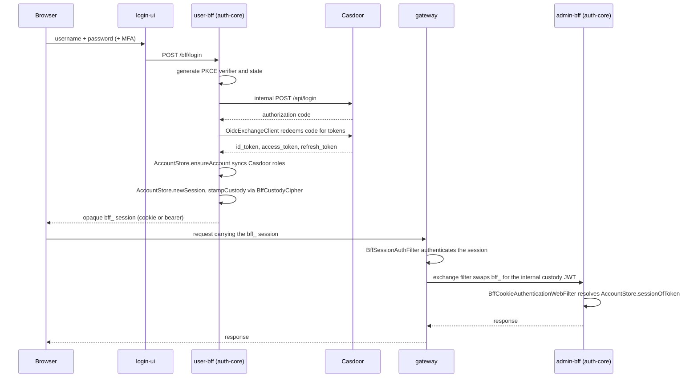

# hugmesh-auth-core

Shared **stateful** HugMesh auth core — the account/session/MFA/Casdoor-admin
infrastructure used by BOTH `hugmesh-user-bff-api` (login + OIDC token-handler) and
`hugmesh-admin-bff-api` (admin features that read accounts/allowlist/suspension and
drive MFA step-up).

## Why a separate module (not `hugmesh-commons`)
`hugmesh-commons` is the **light, stateless** security/tenancy jar that the **gateway**
and every BFF depend on (Casdoor JWT authorities, issuer→domain registry, `ApiException`).
This core is the opposite — reactive **R2DBC** entities/repos, Casdoor-admin **WebClient**,
AES-256-GCM crypto, **TOTP/WebAuthn** — so folding it into commons would drag r2dbc + the
Casdoor/MFA stack onto the gateway's classpath and risk its Boot-4 pin. So:

```
hugmesh-commons   (light; stateless)      <- gateway + ALL services
hugmesh-auth-core (heavy; r2dbc/casdoor/mfa) <- user-bff + admin-bff ONLY
   └─ depends on hugmesh-commons            (no cycle)
```

## Data ownership
The account/session/allowlist/MFA **tables stay in `admin-bff-db`** (admin-bff has ~10
synchronous readers; the mutual-DB-denial NetworkPolicy forbids cross-DB hops). admin-bff
wires the R2DBC-backed stores against admin-bff-db and exposes a thin `/bff/internal/**`
account+session API (mTLS + `X-Internal-Token`); user-bff owns the login/OIDC **endpoints**
and reaches the data via that internal API.

## Where this fits in the auth model
Casdoor is the SSO IdP. `login-ui` renders a **native username/password (+MFA)** form and
POSTs to `/bff/login`; **user-bff** generates PKCE+state **server-side** and calls the
**internal** Casdoor `/api/login`, then exchanges the code and holds per-session JWT
custody/refresh. The browser is **never redirected to Casdoor** and only ever holds an
**opaque `bff_`-prefixed session** — the user never sees their own Casdoor JWT. The gateway
is a pure Casdoor-JWT OAuth2 resource server: a pre-security exchange filter swaps `bff_` →
the internal custody JWT, then the
gateway's JWT validation + the data-driven `GatewayRouteAccessFilter`
(`gateway_route_access` Postgres table is the source of truth) run unchanged
(ADMIN/GAME-MASTER bypass within own domain, SUPERADMIN cross-domain).

This jar is the **shared stateful substrate** behind that flow: the account/session/MFA
stores and Casdoor-admin client that user-bff (login/session custody) and admin-bff
(account reads + MFA step-up) both build on. Login/session/account logic is being
**relocated from admin-bff to user-bff**; the reusable pieces land here so both BFFs share
one implementation while the account/session **data** continues to live in admin-bff-db.

### Native-login sequence



The browser only ever holds the opaque `bff_` value; every Casdoor/custody token stays
server-side, encrypted at rest by `BffCustodyCipher` when custody is stamped. `login-ui`,
`gateway`, and `Casdoor` itself live outside this repo — this diagram traces where
auth-core's own classes (`OidcExchangeClient`, `AccountStore`,
`BffCookieAuthenticationWebFilter`) sit in that cross-service flow.

## Status (extraction landed)
- ✅ `account/` — Account, AccountRow(+repo), AccountStatus, AccountStore, Allowlist(+repo),
  BffSession(+repo), NamespaceGrant(+repo). Self-contained; builds against commons + r2dbc.
- ✅ `casdoor/` — Casdoor-admin client/config, OIDC token-exchange client (`OidcExchangeClient`,
  optionally routed through gated outbound mTLS via `OidcExchangeClientSsl`), BFF-custody
  cipher (`BffCustodyCipher`), MFA challenge/step-up services, raw-JWT refresh.
- ✅ `mfa/` — TOTP, WebAuthn (webauthn4j), recovery codes, enrollment, secret cipher, and the
  R2DBC factor/credential/challenge rows + repositories.
- ✅ `config/` — session-cookie + internal-token web filters, the internal-surface boot guard,
  and `BffCookieAuthenticationWebFilter` (bridges an opaque `bff_` session into a real Spring
  Security `Authentication` for a consumer's own `hasAnyRole()`/`.authenticated()` gates —
  today wired for admin-bff only, see Known Gaps).
- ✅ `provision/` (gateway revocation client), `reserved/` (reserved-name gate),
  `username/` (federation username gate), `web/dto/` (login/register/MFA request DTOs).
- All packages from the extraction blueprint have landed; admin-bff + user-bff adopt this jar.

Build: `./mvnw -o clean package` (resolves hugmesh-parent 2.8.0 + hugmesh-commons 2.1.0
from `~/.m2`) — runs the full test suite as part of `package`. A handful of MFA-repo data-slice
tests need a real Postgres via Testcontainers, so a local run also needs Docker (or `-Dtest=
'!*PostgresTest'` to skip just those). `./mvnw -o clean verify` additionally runs PMD +
Checkstyle + SpotBugs (see Current State / Known Gaps for their actual current enforcement
status). Re-verified 2026-07-22: `clean test` with Docker available — 318/318 tests green
(303/303 without Docker, skipping the Postgres slices), 0 Checkstyle/PMD violations, BUILD
SUCCESS — but `clean verify` is currently **BUILD FAILURE**: the `hugmesh-parent` 2.8.0 bump
fixed SpotBugs's fail switch (`failOnError`, not the no-op `failOnViolation` the historical
2.7.0 config used — see Known Gaps), so `verify` now genuinely fails on 8 real
`EI_EXPOSE_REP2` findings.

## Current State
- **Version 2.4.0** on the unified HugMesh ecosystem baseline: **Spring Boot 4.0.7 /
  Spring Cloud 2025.1.2 / Java 25 LTS** (eclipse-temurin:25), inherited via
  `hugmesh-parent` (metapom) **2.8.0** (which runs **PMD + Checkstyle + SpotBugs** during
  `verify` and pins **testcontainers 2.0.5**; PMD and Checkstyle fail on violation, and — as
  of the 2.8.0 bump — SpotBugs is genuinely in fail mode too (via `failOnError`); see Known
  Gaps for the 8 real findings that currently fail `verify`).
- Depends on `hugmesh-commons` **2.1.0** (stateless security/tenancy; #23 pinned the
  real coordinate — a `2.7.0` commons was never published). **No cycle** —
  commons does not depend on this core.
- **Consumers: `user-bff` and `admin-bff` only.** The gateway depends on commons, NOT on
  this jar (keeping r2dbc/casdoor/mfa off the gateway classpath, per the rationale above).
- Reactive throughout: **Spring Data R2DBC** repositories (no raw SQL strings / inline
  `@Query`), matching the org data-access standard. Crypto via BouncyCastle
  (AES-256-GCM); MFA via **webauthn4j 0.31.7** (WebAuthn) + TOTP. webauthn4j 0.31 migrated
  internally to Jackson 3 (`tools.jackson`), aligned with this module's Boot 4 / Jackson 3
  stack; `WebAuthnService` uses the `CredentialRecord` API.
- **BFF JWT custody (2.1.0)**: `BffSession` carries the OIDC-token-custody columns
  (`access_token_enc` / `refresh_token_enc` / `access_token_expires_at` /
  `custody_updated_at`, admin-bff band-180; alongside the changeset-150 MFA columns
  `mfa_satisfied` / `mfa_satisfied_at` / `amr`). These are **NULLABLE and never written at
  session mint** — `AccountStore.newSession` leaves them null, so a pre-band-180 (2.0.0)
  consumer reads them as null. The custody passthrough lands as `AccountStore.stampCustody`
  / `clearCustody` (delegating to `BffSessionRepository`) plus `AccountStore.sessionRow`,
  which the dark custody endpoints use to stamp/clear/read per-session encrypted tokens for
  the opaque `bff_`-session custody model.
- **List a user's sessions by account (2.2.0)**: `AccountStore.sessionsForAccount` plus the
  `BffSessionRepository.findByAccountIdAndExpiresAtAfterOrderByCreatedAtDesc` derived finder
  back the "my active sessions" read for the session-management UI. The `accountId` MUST be
  derived **server-side** from the validated principal (never a request parameter — a user
  may only list THEIR OWN sessions); expired rows are filtered at the DB (`expires_at >
  now()`), newest-first, and projected to `BffSessionRow` so callers never touch the entity's
  custody/MFA internals.
- **Domain-scoped allowlist + namespace grants (changeset 220)**: `Allowlist` and
  `NamespaceGrant` now carry a `domain` field (composite PK `provider/handle/domain` and
  `grantee/namespace/domain` respectively) closing a BOLA/IDOR gap where a brand-X admin
  could read/write/delete brand-Y's invite or namespace-grant rows. `AllowlistRepository` /
  `NamespaceGrantRepository` expose domain-scoped finders, deletes, and a 3-arg
  `insertIfAbsent(..., domain)`; existing rows back-fill to `"default"`. The registration-gate
  read `existsByProviderAndHandle` is intentionally left **unscoped** (see Known Gaps below).
- **Subject-level revocation (`GatewayRevocationClient.revokeSubject`)**: writes a
  `subject:<casdoorSub>` key so the gateway's `RevocationGatewayFilter` denies a user's
  live custody JWT immediately on role-revoke, instead of waiting out its natural TTL
  (default 1 h). Same best-effort / `broker.gateway-revocation.enabled`-gated pattern as the
  existing coarse homeserver-ban revocation (`revokeCoarse` / `clearCoarse`).
- **DB-generated MFA UUID PKs (2.3.0)**: the `mfa_factor` / `mfa_recovery_code` /
  `webauthn_credential` / `webauthn_challenge` `id` columns are NO LONGER minted in Java —
  the production columns carry a `DEFAULT (gen_random_uuid())::text` (admin-bff changeset
  151/152), so the enroll INSERT OMITS `id` and appends `RETURNING id` to read the
  database-generated UUID back (a plain non-`@Modifying` `@Query` returning `Mono<String>`).
  The MFA-repo data-slice tests run on **real Postgres** (commons `PostgresTestSupport` /
  Testcontainers), since `gen_random_uuid()` and `INSERT ... RETURNING` are Postgres features
  H2 does not honour.
- **Code-side-lens MFA enums**: `FactorType` (`TOTP`|`WEBAUTHN`, the `mfa_factor.type`
  discriminator) and `CeremonyType` (registration|assertion, the
  `webauthn_challenge.ceremony_type` discriminator) wrap the app-owned closed vocabularies as
  `@JsonValue`/`@JsonCreator` lenses over the persisted String columns — R2DBC mapping stays
  byte-identical and the legacy `TYPE_TOTP`/`TYPE_WEBAUTHN` constants delegate to the enum.
- **Casdoor role sync on every login (2.3.1)**: `AccountStore.ensureAccount(provider, handle,
  roles)` SYNCS a non-empty `roles` list onto the account row on every call, not just at
  creation — a Casdoor role grant/revoke now reaches the BFF session on the very next login
  instead of freezing at whatever was true the first time the account was provisioned. The
  null/empty-roles path delegates entirely to the original 2-arg `ensureAccount(provider,
  handle)`, which stays a pure read for an existing account (never rewrites it).
- **Service-local `bff_` session bridge (2.3.2)**: `BffCookieAuthenticationWebFilter`
  (`config/`) resolves an opaque `bff_` session directly via `AccountStore` and populates a
  real Spring Security `Authentication`, so a consumer's own `hasAnyRole()`/`.authenticated()`
  gates (previously only reachable by a real Casdoor JWT, since `oauth2ResourceServer().jwt()`
  is correctly inert to an opaque token) also see native-login sessions. Only works for a
  service with a LOCAL `AccountStore` bean (today: admin-bff only) — user-bff/mod-bff/
  federation-api need a different, HTTP-based bridge (see Known Gaps).
- **Gated outbound mTLS for the OIDC token exchange**: `OidcExchangeClientSsl` optionally
  routes `OidcExchangeClient`'s Casdoor token-endpoint calls (the PKCE code/refresh leg, which
  carries `client_secret` + tokens) through client-cert + cluster-CA mTLS, mirroring
  user-bff's `FederationHttpClientSsl` (same `hugmesh.mtls.client.*` flag/property names).
  Default OFF; degrades to plain HTTP with a warning if the gate is on but the keystore file
  is absent, so a misconfigured pod never crash-loops on boot.
- **Reserved-username canonical sync (2.3.3)**: `ReservedNames.RESERVED` carries the full
  77-label canonical set (`reserved/ReservedNames.java`), kept byte-for-byte in sync with the
  independent copies in `hugmesh-federation-api` and `hugmesh-actions`.
- **Identity-fold correctness fixes (2.3.4)**: `CasdoorAdminClient#usernameOf` now strips a
  trailing `@...` suffix for EVERY provider (previously only `google`), closing a bug where a
  native `casdoor:` account whose handle is email-shaped (`casdoor:alice@gmail.com`) minted an
  `@`-bearing Casdoor role-member id that could never match a real role membership; and
  `AccountStore.idFor` (plus both `ensureAccount` overloads) now folds the write-side account
  id via `trim() + toLowerCase(Locale.ROOT)`, matching the gateway's equivalent read-side fold.
- **Extraction landed**: all packages from the blueprint — `account/`, `casdoor/`, `mfa/`,
  `config/` (session-cookie + internal-token filters + boot guard + the service-local `bff_`
  bridge), `provision/`, `reserved/`, `username/`, `web/dto/` — have been extracted from
  admin-bff; admin-bff + user-bff adopt this jar as login relocates to user-bff.
- **No `spring.cloud.gateway.*` route config lives here** — this is a library, not a
  gateway; the SCG-5 route-namespace move
  (`spring.cloud.gateway.routes` → `spring.cloud.gateway.server.webflux.routes`) is a
  gateway/generator concern and does not touch this module.
- CI is **GitLab** (no GitHub Actions). Single `main` branch; no in-flight feature
  branches or open PRs at time of writing.

## Known Gaps / TODO
Verified against the current code (no invented gaps):
- **Registration-gate allowlist check is cross-brand permissive** — `AllowlistRepository
  .existsByProviderAndHandle` (used by `AccountStore` for the Google/Discord invite check)
  is intentionally left **unscoped** by domain, so a handle invited to brand X's allowlist
  also passes the registration gate for brand Y. Fixing this needs OAuth-flow domain
  context that isn't available at that call site yet — noted as a follow-up in the
  domain-scoping change itself (`AllowlistRepository.java:17-18`,
  `AccountStore.java:129,134`).
- **Gateway revocation writes are a no-op unless explicitly enabled** —
  `GatewayRevocationClient.revokeCoarse` / `revokeSubject` / `clearCoarse` all short-circuit
  to a logged STUB (`Mono.empty()`) when `broker.gateway-revocation.enabled` is `false`
  (the default), so in dev/test/CI (and any prod deployment that hasn't flipped the flag)
  the fast-path JWT/homeserver-token revocation never reaches the gateway — only the
  authoritative Postgres row (`access_suspension`) is written
  (`GatewayRevocationClient.java:49-53,168-196`).
- **MFA BFF wiring not yet complete** — per the Roadmap below, the MFA store/verifier
  substrate (TOTP, WebAuthn, recovery codes) is fully landed here, but per-role MFA
  defaults, step-up enforcement in admin-bff, and the Casdoor MFA bridge for the opaque
  `bff_`-session flow are still outstanding BFF-side work, not in this jar.
- **SSO end-to-end + e2e tests** — the live Casdoor OIDC (PKCE) → opaque `bff_` session
  flow and the gateway exchange-filter path are called out in the Roadmap as not yet
  covered by end-to-end tests.
- **`BffCookieAuthenticationWebFilter` only bridges services with a LOCAL `AccountStore`** —
  it resolves a `bff_` session by calling `AccountStore` directly against the DB, so it only
  works where the service owns the accounts/bff_session tables itself (today: admin-bff).
  user-bff, mod-bff, and federation-api have the identical gap on their own
  `hasAnyRole()`/`.authenticated()` gates but don't have local DB access to those tables —
  they need a different, HTTP-based bridge that resolves the session over the network
  (mirroring the gateway's own `BffSessionAuthFilter`) instead of this class. Documented as
  an intentional, tracked follow-up in the filter's own class-level Javadoc
  (`config/BffCookieAuthenticationWebFilter.java`); not yet implemented anywhere.
- **No column carries the Casdoor UUID `sub`** — `Account` is `{id, provider, handle,
  registrationComplete, roles}` and `BffSession` has no `casdoor_sub`/subject column, so
  nothing derived from the opaque `bff_`-session model can key off the Casdoor UUID subject
  today (only the folded provider:handle id). Surfacing the UUID sub (e.g. for a gateway
  introspect response) would need a new nullable schema column + `AccountStore` plumbing +
  a version bump here, coordinated with whichever consumer needs it.
- **SpotBugs is now genuinely fail-mode and `./mvnw -o clean verify` currently FAILS on real
  findings — re-verified by running the real build** (`./mvnw -o clean verify`, 2026-07-22,
  against the `hugmesh-parent` 2.8.0 / `hugmesh-build-config` 0.5.0 this module now resolves
  post-rebrand). This module's historical "SpotBugs fail mode is a no-op" framing is now
  **stale**: `hugmesh-parent` 2.8.0 switched the plugin config from the silently-ignored
  `failOnViolation` parameter to the real one, `failOnError=true`, so `spotbugs:check` now
  actually fails the build — `verify` ends `BUILD FAILURE` with **8 Medium `EI_EXPOSE_REP2`**
  findings (`AccountStore` ×3, `BffStoredMfaFactorVerifier` ×4, `WebAuthnChallengeStore` ×1),
  even though `clean test`/`clean package` still succeed (PMD and Checkstyle both still run
  clean, 0 violations). `hugmesh-build-config` 0.4.0/0.5.0 already fixed most of this class of
  false positive — Spring constructor-injection findings are now suppressed by CLASS-NAME
  suffix (`*Service`/`*Controller`/`*Repository`/`*Client`/`*Config`/`*Handler`/`*Filter`/
  `*Resolver`), not just layer-package name — which is why the pre-#35 count of 20 findings
  (`account/`, `casdoor/`, `mfa/`, `username/`) is already down to 8: PR #35 fixed the two
  genuine `Account.roles` findings, and the exclude filter's suffix list now quietly covers
  everything else in `casdoor/`/`username/`/most of `mfa/`. The 8 that remain are the same
  kind of Spring-injection false positive, just on classes named `*Store`/`*Verifier` — a
  suffix the exclude filter doesn't cover. Fixing this needs either a `hugmesh-build-config`
  filter change (out of scope here) or a rename/refactor of `AccountStore` /
  `BffStoredMfaFactorVerifier` / `WebAuthnChallengeStore` to a covered suffix — not done in
  this docs pass.

## Roadmap
This jar advances in lockstep with the platform auth roadmap; the next increments are:
- **Adopt the jar across BFFs**: with the extraction landed, complete admin-bff + user-bff
  adoption so login/session logic is fully relocated admin-bff → user-bff against this one
  shared implementation.
- **SSO end-to-end + e2e**: support the live Casdoor OIDC (PKCE) → opaque `bff_` session
  flow and the gateway exchange-filter path, with end-to-end tests.
- **MFA BFF wiring** *(substrate done)*: the shared MFA store/verifier infrastructure
  (TOTP, WebAuthn, recovery codes, `FactorType`/`CeremonyType` enums, DB-generated PKs) is
  fully landed in this library (PRs #4, #6). What remains is BFF-side wiring: per-role MFA
  defaults, step-up enforcement in admin-bff, and the Casdoor MFA bridge for the opaque
  `bff_`-session flow.
- Track the wider platform roadmap where it touches account/session/MFA: multi-tenancy
  superadmin, device-license registry, desktop app governance (SSO sudo), and OWASP
  pen-test + nuclei in CI.

_Grounded in the HugMesh current-state brief and the repo's landed code at
auth-core 2.4.0 (2026-07-19, through the Snapdragon→HugMesh rebrand in PR #36), re-verified
against a real `./mvnw` build on 2026-07-22. Features beyond the brief and the actual code are
intentionally not invented here._
